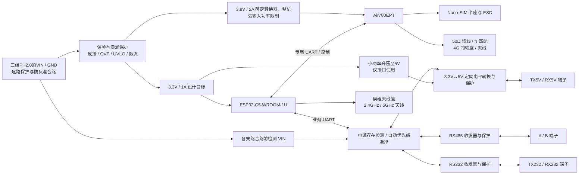

# DTU 主板硬件设计与嘉立创EDA API 绘板规范

版本：V0.4（完整原理图、PCB 布局与布线中；TTL > RS232 > RS485）  
日期：2026-10-09  
主控：ESP32-C5-WROOM-1U  
蜂窝模组：Air780EPT  
硬件根目录：`PCB/`

> 已通过 API 在独立工程 DTU-C5-Air780EPT-HW-V0.1-library 中开始绘制，保留用户原有工程。本文记录需求与实施约束；当前仍为设计草稿，未完成全板连线、PCB 布线、ERC/DRC 或样机验证，不是投板文件。

## 1. 已确认需求与本版决策

| 编号 | 项目 | 规范 | 状态 |
|---|---|---|---|
| REQ-01 | 主控 | 使用 ESP32-C5-WROOM-1U；完整 Flash/PSRAM 订货后缀后续冻结 | 用户确定模组系列 |
| REQ-02 | 4G | 使用 Air780EPT，由 ESP32 通过专用 UART 与 AT 固件通信 | 已确定 |
| REQ-03 | 现场接口 | 提供 RS485、RS232、TTL 接口端子；同一时刻仅一种有效 | 已确定 |
| REQ-04 | TTL | **固定 5V 信号电平**，MCU 侧经 3.3V↔5V 电平转换；不设置电平选择跳帽 | 按用户最新要求 |
| REQ-05 | SIM | 提供实体 SIM 卡座及完整电路，建议 Nano-SIM、带检测开关 | 卡座形式为建议 |
| REQ-06 | 电源 | 从现场接口端子区域的 VIN/GND 取得外部直流电源 | 已确定 |
| REQ-07 | 保护 | 电源反接、过流、浪涌、欠压/过压；外露接口 ESD 与适用的误接保护 | 已确定方向 |
| REQ-08 | 4G 天线 | 主板增加独立 4G 射频同轴连接器；不得假设模组自带天线座 | 已确定 |
| REQ-09 | 无线天线 | ESP32-C5-WROOM-1U 使用自己的双频 Wi-Fi 天线，和 4G 天线分开 | 本版方案 |
| REQ-10 | 供电范围 | **5～12V DC，外部电源最大供电能力 2A**；在板端连接器处定义输入范围 | 用户已确认 |
| REQ-11 | 环境/隔离 | 室内机柜；首版采用共地非隔离方案，最终按线缆与地电位验证 | 环境已确认，非隔离为工程方案 |
| REQ-12 | PCB | 无外壳约束，以小尺寸、低总成本为目标；四层板优先评估 | 用户目标已确认 |
| REQ-13 | 连接器/切换 | 三组独立 PH2.0 4P，通过各路 VIN 自动识别；多路时 TTL > RS232 > RS485；按断电插拔设计 | 用户已确认 |

TTL 的“5V”只定义 TX/RX 信号电平，不代表整板从 TTL 信号脚取电，也不代表端子输出 5V 电源。VIN 是独立电源输入脚。

现有 `docs/hardware-support-matrix.md` 仍以 ESP32-S3 为标题。本次硬件方案采用 ESP32-C5-WROOM-1U，固件 UART、USB、引脚与内存配置必须重新适配；不得沿用 S3 引脚号。该历史文档本次不自动改写。

## 2. 系统架构

### 2.1 电源域

| 网络名 | 电压/能力 | 负载与约束 |
|---|---|---|
| VIN_RAW | 外部输入 5～12V，最大供电能力 2A | 仅入口防护区域；不得连至逻辑器件 |
| VIN_PROTECTED | 经保护后的输入 | DC/DC 输入；记录最坏瞬态与保护阈值 |
| VDD_4G | 3.8V，Buck 额定 2A；可用峰值受整机功率限制 | Air780EPT；由专用 Buck 供电，可受控断电 |
| VDD_3V3 | 3.3V，设计供电能力 1A | ESP32、3.3V 接口逻辑、选择电路 |
| VDD_5V_IF | 约 5.05V，本版负载预算 ≤45mA | TTL 转换外侧电源；不作为外部设备电源输出 |
| USIM_VDD | 由 Air780EPT 的 SIM 电源脚提供 | 仅供 SIM；不得接固定 3.3V/5V |
| GND | 共地 | 本版本无电气隔离，不得标注“隔离 RS485” |

上述 2A、1A、0.2A 是各电源设计容量，不要求同时满载。外部 5V/2A 只有 10W；按总体效率 85% 估算仅约 8.5W 可用，不能沿用三个电源满载 11.9W 的预算。原理图冻结前必须核算 LTE 峰值、Wi-Fi 并发、接口及启动电流，并在最低输入下实测；总输入电流不得超过供电能力、连接器/线束降额能力与限流阈值中的最小值。软件错开发射仅可作为优化，不能代替基本峰值供电能力。

VDD_5V_IF 改为从 VDD_3V3 升压生成固定 5V（初步方案，计入 3.3V Buck 负载）：避免输入正好为 5V、经过线缆和保护后低于 5V 时，普通 Buck 无法保持 5V。若热耗/容量不合适，可改为从 VIN_PROTECTED 升降压生成 5V，比较实际 BOM 后冻结；不得直接把 5～12V 接到 TTL 电源域。3.8V Buck 须核对 5V 输入时的保护压降和最大占空比。

## 3. 端子与接口选择

### 3.1 三组 PH2.0 4P 接口

采用三个独立 2.0mm 间距 PH 系列 4P 板端插座，各自带 VIN/GND 和两根信号。脚号按选定连接器图纸的编号定义，线束加工前必须画插合面视图，禁止将正反视图混用。

| 接口 | Pin 1 | Pin 2 | Pin 3 | Pin 4 |
|---|---|---|---|---|
| J_RS485 | VIN+（5～12V 输入） | GND | 485_A | 485_B |
| J_RS232 | VIN+（5～12V 输入） | GND | TX232（本板输出） | RX232（本板输入） |
| J_TTL | VIN+（5～12V 输入） | GND | TX5V（本板输出） | RX5V（本板输入） |

- 三种模式各用自己的一根 4 芯线；单路接入时自动使用该接口；多路同时接入时按 TTL > RS232 > RS485 选一路。各组电源脚用于给本板供电，不给外部设备供电；TTL 的 VIN 脚仍为 5～12V 输入。
- 每组 VIN 进入独立保护/低压降反灌阻断支路后合并；不得把三个 VIN 在连接器处直接短接。多组接入时不得互相送电；防反灌合路不增加单路 2A 供电能力，也不宣称均流。通信优先级与哪一路实际承担供电相互独立。
- 共地版本三个 GND 相连；防反灌不等于电气隔离，不能解决不同设备地电位差。
- RS232/TTL 本板 TX 接对端 RX、本板 RX 接对端 TX。RS485 A/B 的逻辑极性依最终收发器真值表标注。
- 同规格插头存在插错接口的可能：在插座旁大字标 RS485、RS232、TTL 5V，线束标签对应；不得把同形插座称为跨接口防呆。
- 优先评估立式插座以节省板面积，结合线束插拔空间选择直插或贴片封装。固定孔由初步布局决定，不设置虚构的已冻结长宽。
- JST PH 官方额定电流为 2A（AWG24 条件）；兼容料必须有独立规格书。电源正负线建议采用匹配端子的 AWG24，不能把薄线“PH2.0 成品线”默认视作 2A 线束。验证接触电阻、线损、温升和机柜温度降额。[S6]

### 3.2 电源存在检测与自动优先级

取消人工模式拨码。三种收发电路均装配，上电后检测各接口电源，并通过硬件按 **TTL > RS232 > RS485** 选择唯一通信接口。

**检测定义**：PH2.0 普通插座没有插入检测触点。本版把该接口 VIN 有有效正电压视作接入，不根据 TX/RX 空闲电平或通信报文猜测接入。只插信号线、未接该接口 VIN 的线缆不会被识别；此时即使板子由另一接口供电也一样。若要求识别这种接法，必须改变检测结构或连接器。

| TTL VIN 有效 | RS232 VIN 有效 | RS485 VIN 有效 | 自动选择 |
|---|---|---|---|
| 否 | 否 | 否 | 全关闭 |
| 否 | 否 | 是 | RS485 |
| 否 | 是 | 否 | RS232 |
| 否 | 是 | 是 | RS232 |
| 是 | 否 | 否 | TTL |
| 是 | 否 | 是 | TTL |
| 是 | 是 | 否 | TTL |
| 是 | 是 | 是 | TTL |

1. 每一路检测点位于独立 PTC 之后、防反接/防反灌合路二极管之前。不得检测共同 VIN_OR，否则一条供电线会令三路全被判为接入。
2. U14 LM339BIPWR 三个比较通道生成 `TTL_PRESENT_N`、`RS232_PRESENT_N`、`RS485_PRESENT_N`；第四通道按确定电平处理。输入分压、负压钳位、RC 滤波和独立迟滞参考，避免悬空/欠压抖动。名义阈值约 4.43V 进入、3.92V 退出，最终需核对容差和实测；正常定义仍为板端 5～12V。
3. U13 SN74HC148DR：I7 接 TTL，I6 接 RS232，I5 接 RS485；未用输入固定高。A0/A1 接 U9 74HC139，GS 接 U9 的低有效使能。Y0=`MODE_TTL_N`，Y1=`MODE232_N`，Y2=`MODE485_N`。无有效接口或 EI 被禁用时，三路关闭。[S7][S8]
4. MCU GPIO2 经 Q7 控制全局 `IF_DISABLE`。GPIO2 默认下拉，复位期间三个接口关闭；固件完成 UART 配置、电源稳定等待后只打开总使能，不需要用户或固件指定接口模式。不得把总使能理解成人工模式选择。
5. RS485 未选中时硬件钳住 DE=0，RE# 拉高；RS232 未选中时 EN# 拉高且 FORCEOFF# 拉低；TTL 未选中时 TX 转换器与 RX 缓冲器的 OE# 拉高。RX 使用三态输出共享 FIELD_RX，并通过上拉保持空闲；不能把未禁用的推挽输出直接并联。
6. TTL TX 使用 3.3V→5V 定向转换，TTL RX 使用 3.3V 供电、5V 容忍且 VIH=2V 的 SN74LVC1G125。不能把 5V CMOS 输入门限当作经典 TTL 门限；转换/收发器逐项核对 Ioff 与掉电反灌。[S9]
7. 沿用已确认的断电插拔条件：变更接线后上电自动决定优先级。比较器迟滞只防电压抖动；组合编码器/译码器本身不保证热切换先断后接，首版不承诺带电无缝切换。[S7]
8. 自动选择不自动猜测串口波特率、校验位或对端通信协议；这些仍由固件配置。三路同时接入仅最高优先级通信，其余收发器禁用，但 GND 在本共地设计中始终相连。

| 模式 | 485 驱动 | 232 驱动 | TTL 驱动 | 业务 RX 来源 |
|---|---|---|---|---|
| 未使能/无有效接口/复位 | 禁止 | 高阻 | 高阻 | 上拉空闲 |
| RS485 | 仅发送期间使能 | 高阻 | 高阻 | 485 RO |
| RS232 | 禁止 | 允许 | 高阻 | 232 接收器逻辑输出 |
| TTL 5V | 禁止 | 高阻 | 允许 | 5V→3.3V 缓冲输出 |

## 4. 电源与保护电路

### 4.1 入口拓扑

建议路径：每组 `VIN+ → 独立保险 → 入口瞬态钳位 → 反接与反灌阻断`，三路合并后进入 `OVP/UVLO/总限流及软启动 → 阻尼滤波和储能 → 3.8V/3.3V Buck`；3.3V 再供 5V 接口升压。各入口均需能处理自身反接和钳位能量，不能只在公共合路后放一组保护就视为三路都受保护。保护控制器与背靠背 MOS 可合并反接、反灌、限流和断开功能，具体按器件参考设计实现。

- F1 位于 TVS 上游，使 TVS 故障短路有可验证的切断路径；保险丝优先，PTC 替换须验证其动作时间与高温保持电流。
- 入口采用双向 TVS 可避免反接时把单向 TVS 当正向二极管长时间导通。若采用单向 TVS，必须同时验证其位置与反接能量路径。
- TVS 是瞬态吸收器，不承担持续过压稳压。持续过压由 OVP 断开；限流/短路故障不得导致线缆、端子或 MOS 过热。
- 防反接不能只看 MOS 耐压，必须检查体二极管方向、VGS 钳位、控制器负压能力及关断后反灌路径。
- 滤波器、输入陶瓷和线缆电感组合可能产生热插拔振铃；用阻尼和实测确认，不盲目堆叠 LC。
- TVS 大电流返回入口地，避免经过 MCU、SIM 或射频地回路；若有金属外壳/PE，另外定义机壳地与泄放方案。

### 4.2 选型计算必须提交

| 项目 | 必须满足的关系/验证 |
|---|---|
| TVS 工作电压 | VRWM 高于最大正常输入及其容差 |
| TVS 钳位 | 指定浪涌电流下 VC，加走线尖峰后，低于受保护器件绝对最大值并有裕量 |
| 保护前端耐压 | 前端控制器、MOS、电容、滤波器均覆盖其所在节点的最坏电压；不能只看 Buck |
| 5～12V 方案 | 按 12V 端输入容差与 TVS 实际钳位核算耐压；删除原 36V 输入假设，按满足钳位裕量的最低合适耐压选型以控制成本，不先锁死耐压等级 |
| UVLO/OVP | 含容差、迟滞、线损；阈值不得落进承诺的正常输入范围 |
| 保险/限流 | 正常峰值不误动作；短路和 TVS 失效安全切断；核对 I²t、MOS SOA 和重试温升 |
| Buck | 输入上下限、最小导通时间、输出容差、启动、环路稳定性、短路保护与高温降额 |
| 电感/电容 | 饱和电流覆盖峰值；考虑电容直流偏压衰减、纹波、ESR 和温度 |

### 4.3 Air780EPT 电源

官方网页与手册对 VBAT 上限存在 4.35V、4.3V、4.2V 不同写法。本版选 **3.8V**，内部设计验收窗口暂收紧为 **3.5～4.1V（模组焊盘处，含瞬态）**，不依赖争议上限。正式冻结前以对应批次最新资料复核。[S3][S4]

- 专用 Buck 设计目标 2A，留出布线压降、弱网发射和外围负载余量。
- 两个 VBAT 焊盘都接入低阻抗供电铜面，所有地焊盘按官方封装接地，禁止仅接其中一个电源脚。
- 近模组预留低 ESR 储能电容位置（例如 220～470µF 评估范围）及 10µF、1µF、100nF 去耦；这不是最终定值，按 Buck 稳定性和实测调整。
- 计算并测试 `ΔV ≈ I阶跃×ESR + I阶跃×Δt/C + 走线压降`；不能用大电容代替足够的电源能力。
- 提供 `LTE_PWR_EN`，优先控制专用 Buck EN 或合适的高边负载开关。正常先用 AT 关机，等待完成再断电；强制断电仅作故障恢复。
- 4G 断电时 MCU TX/RTS/DTR 进入不会反灌的状态；有外部上下拉的接口须一并检查。

### 4.4 ESP32 与 5V 接口电源

- 3.3V 使用独立 Buck，近模组去耦；样机目标 3.3V±5%，发射阶跃不触发复位。乐鑫指南推荐至少 600mA 供电能力，本版取 1A 容量。[S2]
- 不用从高压 VIN 经 LDO 直接降至 3.3V 的高耗散方案。
- 5V 接口由 3.3V 小功率升压产生，与 4G 电源分开；目标 5V±5%，本版 TPS61040 仅供接口转换，持续负载预算 ≤45mA，并计入 3.3V 总负载；400mA 是开关限流，不能当作 5V 输出能力。
- 使用 EN/PG 与电源监控实现有序复位；MCU EN 不悬空，RC 依照模组参考电路并结合上电波形验证。
- USB 下载供电与端子电源分清：本版 USB 只作维护连接，板子仍由端子供电。USB VBUS 检测不得接成端子电源回灌路径。

## 5. 主控与 4G 控制

### 5.1 ESP32-C5-WROOM-1U

采用完整模组符号和官方封装，不按裸芯片重新设计晶振/射频匹配。具体订货后缀、Flash/PSRAM 与 OTA 分区在原理图冻结前确定；建议以至少 8MB Flash 需求预算进行选型，最终以内存测算为准。

- 一个硬件 UART 专供 Air780EPT，另一个专供三选一现场接口；程序中不得把 AT 回复与现场数据混入同一 UART。
- 调试优先使用 USB Serial/JTAG，预留 EN、BOOT 和必要下载测试点。
- GPIO 分配表必须逐项核对模组焊盘、启动绑带、USB、Flash/PSRAM 占用与复位电平，禁止照搬 ESP32-S3 或经典 ESP32。
- 若选用输出启动日志的 UART 连接模组，必须处理启动日志隔离/关闭，避免把日志当 AT 指令；不能假定固件启动前引脚静默。
- 每个 LED 加限流；电源、运行、4G 网络、当前接口状态至少有可诊断方式。

### 5.2 Air780EPT

采用 AT 固件，由 MCU 控制联网、重连与错误恢复。按官方资料，Air780EPT 可沿用 Air780EHT 硬件参考设计；不可因名称相近改用 EPM 的固件或未经核对的符号。[S3]

**IO：PIN100 按官方要求下拉到 GND，固定为 3.3V 配置。**上电测量 Vref/UART 电平并记录；PWRKEY、RESET、SIM、USB 等专用脚仍各自遵守手册，不能认为所有脚都变为通用 3.3V GPIO。[S4]

| 功能 | Air780EPT 管脚 | 本板逻辑连接 |
|---|---|---|
| 供电 | VBAT 42、43 | VDD_4G |
| UART 接收/发送 | RXD 17 / TXD 18 | MCU LTE_TX / LTE_RX |
| 硬件流控 | 23 / 22 | MCU RTS → 23；22 → MCU CTS |
| 开机/复位 | PWRKEY 7 / RESET_N 15 | 开漏驱动、测试点 |
| 休眠/状态 | DTR 19、RI 20、STATUS 25、NET_STATUS 16 | 控制/监测，按需分配 GPIO |
| SIM1 | DAT 11、RST 12、CLK 13、VDD 14 | SIM 卡座专用网络 |
| SIM 检测 | DET 79 | 检测触点，核对有效电平 |
| 射频 | LTE_ANT 35 | 50Ω 馈线至主板天线座 |
| 维护 USB | DP 59、DM 60、VBUS 61 | 独立维护接口/测试点 |
| 强制下载 | USB_BOOT 82、VDD_EXT 24 | 按参考设计预留跳帽/测试点 |
| IO 配置/参考 | IO_Volt_Set 100、Vref 99 | 固定 3.3V 配置；Vref 仅参考 |

表中脚号来自手册 3.6 节；完整 GND/NC 表须逐脚核对并纳入引脚清单。[S4] 特别注意：官方管脚名 UART_RTS/CTS 与实际方向存在反向说明，布线以输入/输出方向为准。

PWRKEY、RESET_N 用 NPN/小信号 NMOS 开漏控制，默认释放，不由 MCU 强推高电平。脉宽与开关机状态机按指定固件手册实现，禁止把复位当关机；VDD_EXT 不作为板上外设电源。

Air780EPT 文件下载能力有限，不能默认缓存完整 ESP32 OTA 镜像。MCU OTA 应评估串口流式传输/分块、TLS 与双分区，实测速率、重传和掉电恢复。[S3]

## 6. 三类现场接口电路

### 6.1 RS485（两线半双工）

- 3.3V 逻辑收发器，具有接收失效保护、热保护和满足目标波特率的性能；总线故障耐压按误接场景选择。
- A/B 入口布置适用于 RS485 共模电压的 TVS；配对串联限流/脉冲电阻、可选共模电感，核对压降与信号边沿。
- DE 默认下拉；可合并 DE 与 /RE 用一根方向信号，但须记录高/低时的实际工作状态。
- A-B 间 120Ω 终端电阻通过跳帽/拨码使能，默认不装或断开；只在线缆两端启用。
- 偏置电阻可配置，默认策略结合接收器的内部失效保护决定；不得每台设备都强偏置。
- 偏置设计计算全部终端和节点并联后空闲差分电压，覆盖接收门限、漏电、温差和噪声余量。
- 本版目标业务速率建议 1200～115200bps；最大距离由线缆/速率/布线实测定义，不写未经验证的“1200m”。

### 6.2 RS232（TX/RX/GND）

- 使用带电荷泵的真实 RS232 收发器；MCU 侧兼容 3.3V，外侧为 RS232 正负电压。
- 选带发送器关闭高阻能力的型号；外部接收输入掉电时不反灌。
- 电荷泵电容的容值、耐压与放置按最终芯片手册；不能混用不同 MAX3232 兼容料的推荐值。
- TX/RX 端口用兼容 RS232 正负摆幅的双向 ESD 器件，不用普通 3.3V 钳位二极管。
- 默认三线接口，不提供现场 RTS/CTS；所选对端若要求硬件握手需修改端子方案。

### 6.3 TTL（固定 5V）

- **TX：MCU 3.3V → 定向电平转换 → 5V TX5V；RX：RX5V → 定向电平转换 → MCU 3.3V。**
- 使用固定方向的独立通道，或具有独立方向设置的双电源转换器；有统一 DIR 的双通道器件不能同时承担方向相反的 TX/RX，必要时用两个单通道器件。
- 接收侧按真正 TTL 阈值选型：目标 VIH≤2.0V、VIL≥0.8V；不能仅因为器件用 5V 供电就认为它接受 5V TTL。
- 发送目标 VOH≥2.4V、VOL≤0.4V，具体在约定负载下验证；无负载高电平接近 5V。若对端实为 5V CMOS，须再核验它的 VIH 与输出负载。
- 两侧电源时序、OE 默认关闭、Ioff 和断电容忍必须满足要求；选定器件须核查全部限制。
- 端子入口 ESD + 串联限流，并按设备端电压容差核对钳位。TVS 并不等于“允许持续接 24V”。
- 若要求 RX/TX 误接 VIN 持续不损坏，必须增加故障保护开关/耐压缓冲和限流，明确误接电压与时间后选型；未验证前禁止作此承诺。
- TTL 只用于短距离共地连接，建议样机先验证 ≤0.5m 线缆；长线场景优先 RS485。无外供 5V 脚。

## 7. SIM 卡槽

- 建议 Nano-SIM 带检测触点卡座，完整装配；“预留”不能仅画一个空封装。
- 使用 SIM1，VCC/RST/CLK/IO/GND 按卡座触点定义连接；不得以卡座焊盘顺序猜 ISO 触点。
- 卡座电源由 USIM_VDD 提供，支持电压由模组管理；不接 VDD_3V3/VDD_5V_IF。
- 卡座入口放低电容 ESD 阵列，泄放路径短；供电去耦靠近卡座，信号串阻/小电容按官方参考设计留位，最终值经识卡与波形验证。
- CLK/RST/IO 走线短、连续地参考，远离 Buck SW 节点和 LTE 馈线；不要加未验证的大电容。
- DET 按卡座常开/常闭触点与模块有效电平处理；不支持热插拔的固件按断电换卡使用，ESD 保护不代表支持热插拔。
- 保留卡片插拔空间、卡托行程、外壳开孔；标明卡片方向。卡壳接地遵循器件图纸。

## 8. 天线与射频

### 8.1 Air780EPT 外置 4G 天线座

拓扑：`LTE_ANT → π匹配预留 → 50Ω馈线 → 低电容射频ESD（按射频评估）→ U.FL/I-PEX同轴座 → 转接线/4G天线`。

- 主板实际装配一个指定系列同轴座，和线缆插头精确匹配；“I-PEX”只是品牌/俗称，不是完整接口型号。
- 默认建议板上微型同轴座 + 外壳 SMA 母座转接线。直装 SMA 是可替代机械方案，不能与 U.FL 形成两个并联 RF 支路。
- π 匹配以串联直通/0Ω、两并联支路 DNP 为初始预留，具体是否需要隔直及其值按模组参考图确认，匹配值由测试确定。
- 信号按板厂实际四层叠层计算 50Ω；禁止把网上某个固定线宽直接用于本板。
- RF 尽量同层、短而直，无长测试支桩；连接器地与匹配地就近多过孔，连续参考地。
- 4G 天线覆盖模组实际使用的蜂窝频段；在装入最终外壳、连接实际馈线后测试驻波、驻网、吞吐与弱网。
- 射频 ESD 必须有工作频段插损/电容依据，普通大电容 TVS 不得直接挂到 LTE_ANT。

### 8.2 ESP32 无线天线

ESP32-C5-WROOM-1U 自带外部天线连接器，使用匹配的 2.4GHz/5GHz 双频 50Ω 天线；不要把 WROOM-1 的板载天线禁布图照搬给 1U。[S1] 按所选 1U 版本核对底部焊盘及可能的附加 RF 引脚，未用 RF 功能按官方参考处理。

Wi-Fi 和 4G 使用两根独立天线及连接器，外壳中尽量分离，馈线远离开关电源；具体距离由尺寸与共存测试确定。禁止用简单分叉线共用一根天线。

## 9. PCB 设计规范

### 9.1 叠层与区域

成本原则：先用四层紧凑布局评估总 BOM、板费和装配费；不为缩小几毫米采用更昂贵工艺。优先常规阻容尺寸、普通通孔和成熟器件，不用盲埋孔。两层板仅在地回流、射频、温升和面积审核通过且总成本确实更低时作为候选。V0.4 初步板框为 60 × 70mm；在电源、射频、插拔空间和布线审查完成后再评估缩小。

推荐 L1 器件/关键信号、L2 连续地、L3 电源/辅助地、L4 辅助信号/地。候选 JLC04161H-7628：RF 0.32mm / 侧地间距 0.25mm 算得 49.50Ω；USB 单线 0.24mm / 线间距 0.15mm 算得 90.05Ω，详见 [叠层与阻抗计算](docs/四层叠层与阻抗计算-V0.4.md)。RF 优先 L1 参考 L2；任何改层都检查返回路径。非隔离版不割裂地平面，不为“模拟地”随意切出孤岛。

布局顺序：端子/天线座/SIM/安装孔 → 输入保护 → Buck → 模组 → 收发器 → 去耦/小件。

- 入口保护靠端子；DC/DC 热回路紧凑，SW 铜区小且远离天线/SIM。
- 4G Buck 与储能靠近模组 VBAT；RF 馈线与电源大电流路径避免互相穿插。
- RS485/RS232/TTL 保护靠外部端子，先经过保护再进入内部电路。
- 模组底部 GND、开窗、过孔和钢网严格依官方封装；不凭器件搜索名称认可封装。
- USB 分别布置主控和 LTE 维护通道；USB D+/D− 不允许两台设备并接。使用 USB-C 时按独立 UFP 端口设计 CC 与 VBUS 检测。

### 9.2 网络类别（项目初始目标，非板厂能力声明）

| 类别 | 初始规范 |
|---|---|
| 普通信号 | 建议 6mil 线宽/6mil 间距；密集封装局部按板厂能力与审核放宽 |
| 入口/主电源 | 按实际铜厚、2A 级容量预算、允许温升与压降计算，优先铜面；不统一套 6mil |
| VDD_4G | 低阻抗宽铜面，避免细颈；换层并联过孔并计算承载 |
| RF_LTE | 50Ω 单端，板厂阻抗目标容差建议 ±10% |
| USB | 90Ω 差分，按端口速率、叠层和模块指南约束 |
| RS485 | 成对、连续回流、端口保护对称；外部线缆目标阻抗与终端配套 |
| 高压 VIN 区 | 正常电压及瞬态共同决定间距，优先 ≥0.5mm 到敏感逻辑，不能用此值替代绝缘评估 |

丝印包含型号/版本、端子功能、输入极性与最终范围、TTL 5V、TTL > RS232 > RS485 优先级、终端电阻装配位、SIM 方向、天线用途。禁止覆盖焊盘或藏在装配后不可见位置。

## 10. GPIO 与网络命名约束

V0.4 已按模组物理脚号完成连接；完整预期网络记录在 `manifests/full-schematic-netmap.json`。原理图导出已完成 610 项关键引脚断言，PCB 再核对全部 697 个逻辑引脚；ESP32 的重复接地焊盘逐个检查。变更 GPIO 必须重新核对绑带、方向、电压域和上电状态。

| 功能组 | 必需逻辑信号 |
|---|---|
| 模组 UART | MCU_LTE_TX、MCU_LTE_RX；优先预留 MCU_LTE_RTS、MCU_LTE_CTS |
| 模组控制 | LTE_PWR_EN、LTE_PWRKEY_OD、LTE_RESET_OD；状态/休眠按资源分配 |
| 业务 UART | FIELD_TX_3V3、FIELD_RX_3V3、RS485_DE |
| 模式 | MCU_IF_ENABLE / IF_DISABLE；硬件优先编码与译码，无 MCU 人工模式选择 |
| TTL | TTL_TX_5V、TTL_RX_5V，与 MCU 侧网名严格分开 |
| 调试 | MCU_USB_DP/DM、EN、BOOT；LTE_USB_DP/DM/VBUS 独立 |
| SIM/RF | USIM_VDD、USIM_CLK、USIM_RST、USIM_DAT、USIM_DET、LTE_ANT |

电源信号不可用含糊的 `VCC` 混接。模组 TX/RX 与“MCU视角 TX/RX”必须注明方向。每一电源输入脚均进行电压域检查。

## 11. 嘉立创EDA API 绘板实施规范

### 11.1 工程和资料

- 正式工程建议命名 `DTU-C5-Air780EPT-HW-V0.1`，单独创建，不能修改此前测试工程或用户其它工程。
- 每批写入前检查 Bridge `/health` 的 `service == easyeda-bridge`，查询窗口并锁定 windowId。多窗口时明确目标，禁止使用上次会话遗留 ID。
- 写入前验证 projectUuid、documentUuid、documentType；任何不符立即停止，不根据标签标题猜目标。
- `openProject()` 会丢弃当前未保存内容；不得无条件切换。无法确认安全时使用专用空窗口或先由用户处理未保存状态。
- 将官方资料版本、来源链接、下载日期与文件哈希记录到资料清单；封装来源与库 UUID 固定。
- 元件必须有真实 MPN、符号、封装、焊盘映射和 BOM 属性；不得通过“搜索返回第一个”自动选料。无经核对的 Air780EPT 库时先导入官方参考库。

### 11.2 原理图分页

| 页 | 内容 | 验收重点 |
|---|---|---|
| 01_Power_Protection | 端子供电、入口保护、三路电源 | 极性、耐压、限流、反灌、上电时序 |
| 02_ESP32_C5 | 主控、复位、下载、指示灯 | 模组脚号、绑带、存储版本 |
| 03_Air780EPT | VBAT、AT UART、控制、维护下载 | 3.3V 配置、流控方向、电源开关 |
| 04_SIM_RF | SIM 卡座、ESD、LTE 天线座及匹配 | SIM 电源域、射频网络 |
| 05_Field_Interfaces | RS485、RS232、5V TTL、端子 | 禁用高阻、外部保护 |
| 06_Auto_Selection | 比较器、优先编码、互斥译码 | TTL > RS232 > RS485、无电关闭 |
| 07_LTE_Control | UART 缓冲、开机/复位/状态控制 | 掉电隔离、3s 开机脉冲、流控方向 |
| 08_Power_Rails | 3.8V / 3.3V Buck 与 5V 升压 | 热回路、反馈、去耦和功率预算 |

### 11.3 API 调用要求

使用本机 `easyeda-api` 技能，执行前读取 `references/classes/` 的完整方法签名及涉及的枚举/接口，不凭经验拼 API。相关类别包括 DMT_Project、DMT_Schematic、DMT_EditorControl、SCH_PrimitiveComponent、SCH_PrimitiveWire、SCH_Document、PCB_Document、PCB_Primitive*、PCB_Drc。

- API 代码使用 `await` 和明确 `return`；不使用 console.log 作为结果。桥接代码不加入会吞掉后续代码的行注释。
- 原理图坐标单位 **0.01 inch = 0.254mm**；PCB 坐标单位 **1mil = 0.0254mm**。脚本内部用 mm，调用边界显式转换：SCH=mm/0.254；PCB=mm/0.0254。
- 使用官方枚举成员及已核对数值映射，不能随手把 `1` 当任意层号/类型。
- 修改图元按技能要求使用异步图元方式并提交；检查每个创建/保存返回值，随后重新读取验证。
- 生成导线时获取真实引脚连接点，网络由电气连接及网络标识构建；文本标签或图形线重叠不代表已连接。
- 仅建立 BOM 不等于完成原理图；仅放置封装不等于完成 PCB。自动布局/布线只作为候选结果，仍需检查 RF、电源和保护回路。
- 网表导出、同步 PCB、DRC 和生产文件导出逐项核对当前版本 API；不可用时记录人工步骤，不能把未执行检查标为通过。

### 11.4 幂等、检查点与结果证据

1. 输入清单先做 dry-run：列出待创建页、器件数、网络数、缺失 MPN/封装/脚号及阻断项；dry-run 不写 EDA。
2. `manifest.json` 记录工程/页/图元 UUID、位号、库 UUID、MPN、参数、连接、脚本版本与校验值。
3. 每页小批量生成并保存，读回器件、引脚、网络数量及关键连通；超时先查询是否已经创建，不能立即重复执行。
4. 再次运行复用位号与 UUID，发现同位号异器件时报告冲突。回滚只操作本次创建清单，不批量删除未知对象。
5. 完成原理图：ERC（若工具支持）+ 网表断言 + 人工电气审查，之后再同步 PCB。
6. PCB：板框/层叠/规则→器件布局→关键网络布线→其余布线→铺铜→DRC→截图与人工审阅。
7. 保存、重新打开、回读关键电源/接口网络，确认持久化；导出 BOM、坐标、Gerber/钻孔和版本对应关系后才算交付。

工程目录：`PCB/docs/`（计算与资料清单）、`PCB/eda/`（工程导出）、`PCB/scripts/`（生成/校验）、`PCB/manifests/`（映射）、`PCB/reports/`（ERC/DRC与截图）、`PCB/release/`（冻结输出）。当前完整原理图与初步 PCB 已生成，布线和工程审查进行中，不生成或标注未审核的生产文件。

### 11.5 必须自动检查的电气断言

- VIN_RAW/VIN_PROTECTED 不连接任何 MCU、UART 或 SIM 电源脚。
- VDD_4G 接两路 VBAT；USIM_VDD 不连接系统固定电源。
- Air780EPT PIN100 配置正确；MCU TX→模组 RX，流控按实际方向。
- RS232 外部正负信号与 MCU 之间必须经过收发器。
- TTL 5V 与 MCU 3.3V 之间必须经过正确方向、正确阈值的转换器。
- 三路 RX 不直连；任意有效模式最多启用一个外部发送接口；复位全部禁用。
- LTE_ANT 只通向匹配/ESD/连接器，未误接电源或地；匹配 DNP 不导致主信号断路。
- 所有 GND、NC、电源脚处理可解释；未连接告警逐条有理由，不能一键豁免。

## 12. BOM 与投板前冻结项

| 器件组 | 选型必须核对 |
|---|---|
| ESP32 模组 | 1U 完整订货码、Flash/PSRAM、官方封装与 3D |
| Air780EPT | AT 型号/批次、LGA 官方库、IO 配置、固件版本 |
| 电源前端 | VIN 范围、浪涌规格、钳位/耐压协调、反接与短路行为 |
| 电源转换 | 3.8V/3.3V Buck + 3.3V→5V 接口升压；最低输入压差、动态、效率、EMI、总功率预算 |
| RS485 | 逻辑兼容、失效保护、驱动禁用、故障耐压、速率 |
| RS232 | 正负电平、外部 TX 高阻、掉电保护、电荷泵器件 |
| TTL 转换 | 固定双向独立通道、3.3/5V、TTL 阈值、OE/Ioff |
| 模式选择 | 逐路 VIN 检测、TTL > RS232 > RS485、复位全关闭、输入输出隔离；断电插拔 |
| SIM | 卡座触点/检测/外壳、低电容 ESD、机械空间 |
| RF | 连接器完整型号、馈线插头、天线频段、ESD 插损 |
| 端子 | 三组 PH2.0 4P，具体 MPN、AWG24 配套端子、插合面脚序、温升与丝印 |

所有 MPN 在原理图冻结时补齐，不以“MAX3232 类”“TVS 通用”作为最终生产 BOM。替代料需重新核对引脚、封装、关闭状态及电气参数。

## 13. 验证计划与放行标准

| 阶段 | 验证 | 通过标准 |
|---|---|---|
| API | 分页、器件、网络、保存重开 | 与 manifest 一致，无重复位号/丢失连接 |
| 电气规则 | ERC、网表、电压域、方向 | 错误为零，警告逐条审查签注 |
| PCB | DRC、未布通、铜面、机械 | 未布通为零；错误为零；射频/电源人工审查通过 |
| 上电 | 限流电源下逐路电压、短路排查 | 3.3V/5V 在目标容差内，LTE 焊盘暂定 3.5～4.1V |
| 电源动态 | 输入最低/最高、弱网发射、Wi-Fi与LTE并发 | 不复位、不掉网；波形与温升符合器件额定值 |
| 接口 | 三模式回环、真实从机、未选端口 | TX/RX 正确、无冲突，禁用状态真实高阻 |
| TTL | 2.0V高/0.8V低边界输入，约定负载输出 | 阈值匹配，MCU 引脚不承受 5V，掉电不反灌 |
| 自动选择 | 8 种有电组合、复位总关闭、欠压迟滞、逆接/拔线检测、合路不误识别 | 稳态只选一路，TTL > RS232 > RS485；反接/无电不计入；阈值实测符合预算 |
| RS485 | 终端/偏置组合、方向切换、开路短路 | 通信稳定，空闲状态明确，驱动无锁死 |
| SIM | 识卡、驻网、重启、移除恢复 | 按固件支持行为工作，不出现异常供电 |
| 射频 | 最终天线/外壳下驻网、弱网、共存 | 满足产品指标；不能只凭 RSSI 判定匹配通过 |
| 异常 | 反接、短路、慢升降压、热插拔 | 无危险温升/损坏，按策略恢复 |
| 稳定性 | 三接口各自测试、联网与周期重连 | 样机建议累计 ≥72h；记录错误率和复位原因 |

ESD 初步工程目标可取接触 ±4kV、空气 ±8kV；这是拟定测试目标，不是认证结论。EFT/浪涌等级取决于线长、布线、外壳接地和行业环境，当前待定，必须先定义波形、源阻抗、耦合方式与性能判据，再选 TVS 和安排测试。

未完成精确 GPIO/封装、5V 输入功率预算、保护配合、EMC 场景与机械冻结前，不放行生产文件。可以继续原理图框架和器件库核对。

## 14. 待确认清单

| 优先级 | 项目 | 当前处理 |
|---|---|---|
| 已确认 | 外部 VIN 电压范围与供电能力 | 5～12V、最大 2A；工程侧核算 5V 最坏功率预算 |
| 工程核对 | 环境与接口保护 | 室内机柜、共地版；实际线长、地电位与误接条件在样机验证前补齐 |
| 已确认目标 | PCB 尺寸、外壳、成本 | 无外壳，尽可能小且低成本；工程布局确定尺寸/孔位，不再等待用户给板框 |
| P1 | ESP32 订货后缀与 OTA/缓存容量 | 建议按 ≥8MB Flash 需求评估 |
| 已确认 | 模式选择方式 | 检测各接口 VIN 自动选择，TTL > RS232 > RS485；三组 PH2.0 4P 独立接线，断电插拔 |
| P1 | Nano-SIM、天线座与外壳转接方式 | 建议 Nano-SIM + U.FL 转 SMA |
| P1 | 温度、线缆长度、速率、成本 | 逐项定义后选最终 MPN 与试验条件 |

TTL 已确认固定 5V，不属于待选事项。

## 15. 官方依据与版本

以下来源在 2026-10-09 核对。本文中的电源容量、端子定义、互斥实现、四层叠层与测试目标为本项目工程方案，不冒充厂家要求。

- [S1：乐鑫 ESP32-C5-WROOM-1 / 1U 技术规格书 v1.3](https://documentation.espressif.com/esp32-c5-wroom-1_wroom-1u_datasheet_cn.html)：模组、订货型号、脚位、天线座和封装依据。
- [S2：ESP32-C5 硬件设计指南——原理图检查](https://docs.espressif.com/projects/esp-hardware-design-guidelines/en/latest/esp32c5/schematic-checklist.html)：供电/复位/接口原则；裸芯片部分不能直接当模组外围照抄。
- [S3：合宙 AT 模组产品资料页](https://docs.openluat.com/atmozu/product/shouce/)：Air780EPT 与 EHT 对应关系、IO 电平、参考库和参考原理图下载入口。
- [S4：合宙 Air700ECT/Air780EPT/EHT/EVT/EVT-1.8V/EG2/EGT 硬件手册 V1.4](https://docs.openluat.com/atmozu/product/file/Air700ECT%26Air780EPT%26EHT%26EVT%26EVT-1.8V%26EG2%26EGT%E7%A1%AC%E4%BB%B6%E6%89%8B%E5%86%8CV1.4.pdf)：IO 配置及 3.6 节管脚表；VBAT 上限存在内部文字差异，按第4节收紧处理。
- [S5：easyeda-api 技能仓库](https://github.com/easyeda/easyeda-api-skill)：API 使用流程；本机已验证版本 1.1.44。调用签名以实际安装版本 `references/` 为准。

- [S6：JST PH 官方规格](https://www.jst-mfg.com/product/pdf/eng/ePH.pdf)：2.0mm 间距、2A 额定值及其 AWG24 条件；最终配套线束须按具体端子型号核对。

## 16. 下一阶段交付顺序

1. 已完成：八页原理图、196 个物理器件、610 项关键连接断言及自动选择稳态检查。
2. 已完成：四层 PCB、60 × 70mm 初始板框、196 个封装与全部 705 个焊盘的网络映射；布线进行中。
3. 完善电源热回路、RF/USB 阻抗线、地平面与过孔；继续其余连线并消除未布通。
4. 核对 TTL 钳位、RS232 RX 保护、SIM 检测触点、BOM 属性匹配告警，以及 5V 输入最坏功率预算。
5. DRC/原理图/保护/射频审查通过后导出装配与生产审核包；样机验证另外记录，不把 CAD 检查当作实物通过。

### 本版自动选择补充资料

- [S7：TI SN74HC148 优先编码器手册](https://www.ti.com/lit/ds/symlink/sn74hc148.pdf)：低有效输入与编码、I7 最高优先级、GS/EI 真值表，以及输入变化可能产生组合毛刺。
- [S8：TI LM339B 手册](https://www.ti.com/lit/ds/symlink/lm139.pdf)：开集电极比较器、供电/输入共模范围，分压、迟滞与上拉设计依据。
- [S9：TI SN74LVC1G125 手册](https://www.ti.com/lit/ds/symlink/sn74lvc1g125.pdf)：3.3V 供电时 VIH=2V、VIL=0.8V，5.5V 输入容忍与 Ioff。

## 17. V0.3 自动选择实施记录（历史，已由 V0.4 接续）

- 已取消 SW1 模式拨码；保留三组 PH2.0 独立电源输入、保险与反灌二极管合路。
- 已绘制逐路比较检测、优先编码/互斥译码、RS485 DE 钳位、RS232 强制关闭和 GPIO2 总使能。
- 检测分压 15kΩ / 1kΩ，参考分压 124kΩ / 10kΩ，迟滞反馈 910kΩ，输出上拉 4.7kΩ；100nF 输入滤波。降低检测源阻抗以减少漏电引起的门限偏移。
- 90 个物理元件导出唯一标识完整；自动选择相关 182 项引脚网络断言通过；8 种接入组合 × 总使能开/关共 16 种稳态逻辑检查通过。此结果不替代 ERC、PCB DRC 或实物验证。
- 工程草稿备份：`PCB/eda/DTU-C5-Air780EPT-V0.3-auto-priority.epro2`；校验报告：`PCB/reports/自动接口选择校验.md`。这是 V0.3 时点的状态；V0.4 已完成上述原理图连接，当前在进行 PCB 布线和审查。

## 18. V0.4 实际器件与检查记录

以下内容记录 2026-10-10 的实际工程；实时布线数量和未完成项见 [实施与待审查清单](reports/V0.4实施与待审查清单.md)。

- 输入：每路 Littelfuse 1812L200/16DR（C439873，16V、2A 保持）→ SS34 防反灌合路 → 公共 SMBJ12A → TPS259470ARPWR（C3662799）。旧 MF-MSMF200-2 仅 8V，已替换。公共 TVS 不等同于各入口均通过独立浪涌试验。
- eFuse：UVLO 232k/100k、OVLO 1M/100k、ILM 1.87k，限流典型约 1.78A；DVDT 2.2nF。瞬态钳位与输入绝对最大值按实际器件协调。
- RS485：THVD2410DR（C1849398，500kbps，±70V 总线故障保护）与 SM712、10Ω 串联电阻；120Ω 终端默认不装。
- RS232：MAX3221；TX TVS 为 SMF7.0CA-TP（C712347），RX 目前为 SMF12CA，仍需核对对端最大正常摆幅和钳位配合。
- 电源：AP63200 可调约 3.8V、AP63203 固定 3.3V、TPS61040 升压约 5.05V；5V 只供接口逻辑，禁止作为外部供电。
- 布局：四层、60 × 70mm；SIM 与 USB 插口朝板边，LTE 天线座独立，Air780EPT 周围按 3mm 初始器件间距留空。
- 默认通孔目标：孔径 0.30mm、焊盘外径 0.60mm；已修正工程原默认孔径/外径顺序异常。大电流换层须按数量、温升与压降单独复核。
- 编码：Bridge 脚本按 UTF-8 读取，避免中文 MPN/属性乱码；本客户端 PCB 网表使用 `JLCEDA` 格式导出成功。

参考：[Littelfuse 1812L 数据表](https://www.littelfuse.com/~/media/electronics/datasheets/resettable_ptcs/littelfuse_ptc_1812l_datasheet.pdf.pdf)、[TI THVD2410 数据表](https://www.ti.com/lit/ds/symlink/thvd2410.pdf)、[MCC SMF 系列数据表](https://development.mccsemi.com/pdf/products/SMF5.0A_SMF200CA(SOD-123FL).pdf)。
