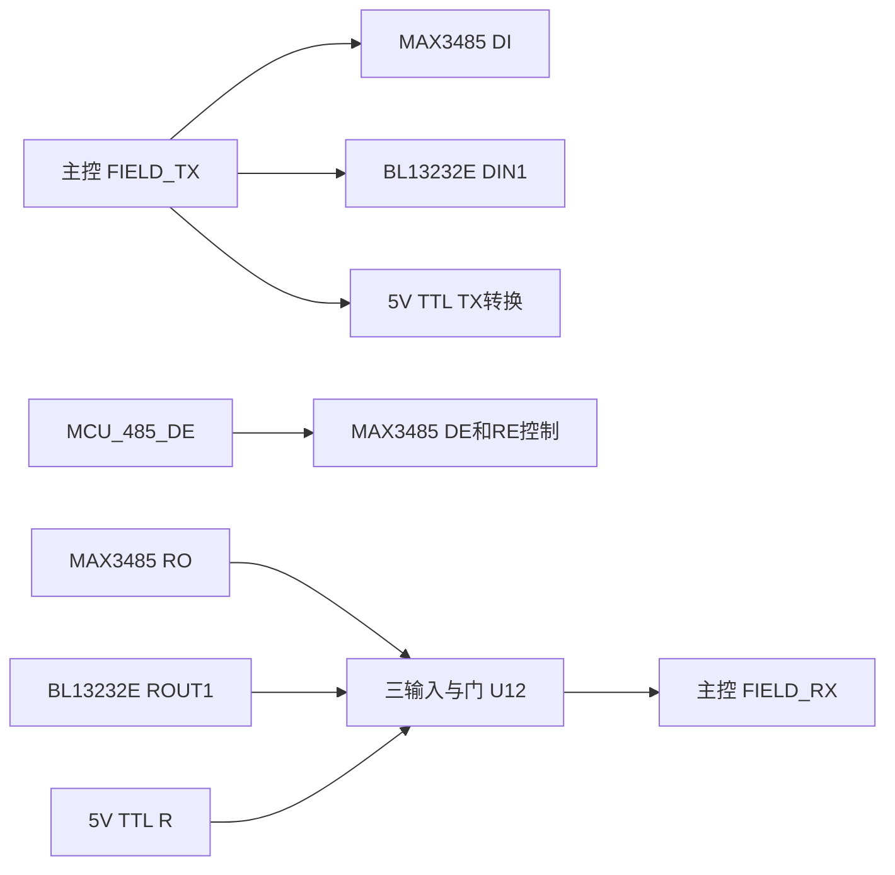

# V0.11 接口修改与验证记录

更新：2026-10-12。已修改并保存嘉立创EDA中的九页原理图及四层 PCB，采用 MAX3485 和 BL13232E，删除比较器接口检测/选路。工程是从最新 V0.10 保存版本复制得到的独立 V0.11；原版本保留。

## 实施结果

| 项目 | V0.11 实施 |
|---|---|
| RS485 | U6 MAX3485ESA+，SO8，C1545222，3.3V供电 |
| RS232 | U7 BL13232ETS（BL13232E系列），TSSOP16，C2999161，3.3V供电 |
| 接收合并 | U12 SN74LVC1G11DCKR，SC70-6，C529281；替换原 TTL 接收缓冲器 |
| TTL | 保留 U8 的3.3V→5.05V发送转换；5V接收直接接与门容忍5.5V的独立输入 |
| 485偏置 | R100/R101 各270Ω/1%，A上拉、B下拉；R32终端120Ω默认不装 |
| 器件数量 | 173→154，减少19；默认装配148个 |
| 四层 PCB | 60×70mm；重新安排 BL13232E 四颗电荷泵电容，六条电荷泵连线约1.5～5.4mm |

删除位号：U14, D15, D16, D17, R102, R103, R105, R106, R107, R111, R112, R113, R117, R124, C100, C101, C102, C105, C110。R100/R101复用为偏置电阻；R38复用为485_RX_RAW的10k上拉。保留三组接口输入保护、供电合路、TTL电平转换、LTE断电隔离及八个独立GPIO指示灯。

## 接哪个就用哪个

一次只连接并供电一个业务接口，切换前断电；不用软件配置 RS485/RS232/TTL 类型。

发送信号共用：RS232 和 TTL 输出随 FIELD_TX 变化，RS485 只在 DE 拉高期间驱动 A/B。接收合并为 `FIELD_RX = 485_RX_RAW AND 232_RX_RAW AND TTL_RX_BUF`，各路空闲为高，任一路低使主控接收为低。推挽接收输出没有直接并接。

RS485继续使用主控按帧控制方向：上电 DE=0，发送前拉高，等待最后停止位完全发出后拉低。其它接口使用同一个发送程序时，未连接的485接口被驱动不影响通信。这与软件选择接口类型是两件事。

## 与原板草案的差别

照片和电阻测量支持原板二极管接收合并及 DI 接地的逐位方向候选，二极管型号与极性没有完整测定。本版实现相同的单接口使用方式，使用一颗与门处理接收，保留标准 DI 数据和 DE 按帧控制。

与门避免二极管压降叠加收发器 VOL 后挤占 ESP32-C5 低电平余量。U12在3.3V供电时输入允许5.5V；在3.0～3.6V供电范围输入 VIH=2V、VIL=0.8V，接收器输出与其匹配。输出接主控单个高阻输入，数据手册100µA条件下VOL≤0.1V、VOH≥VCC−0.1V，对主控门限留出余量。[TI 数据手册](https://www.ti.com/lit/ds/symlink/sn74lvc1g11.pdf)、[ESP32-C5 数据手册](https://www.espressif.com/sites/default/files/documentation/esp32-c5_datasheet_en.pdf)

MAX3485只保证开路失效保护，终端状态的空闲需外部偏置。采用270Ω/1%两端偏置；按最低3.0V、两只120Ω终端和保守的32个12kΩ并联接收负载，并计入R30/R31各10Ω/5%的串联电阻估算，总线空闲差分约0.25V，高于0.2V门限。该估算不替代最终总线线长、节点数量及波形测试。MAX3485不能继承旧THVD2410的故障耐压能力。[ADI 数据手册](https://www.analog.com/media/en/technical-documentation/data-sheets/MAX3483-MAX3491.pdf)

BL13232E四颗电荷泵电容各100nF，闲置通道RIN2/DIN2接地、DOUT2/ROUT2显式不连接。使用11脚DIN1、12脚ROUT1、13脚RIN1、14脚DOUT1，并修正旧MAX3221电路中发送输出引脚映射的问题。[贝岭数据手册](https://www.belling.com.cn/media/file_object/bel_product/BL13232E/datasheet/BL13232E_V1.3_en.pdf)

部分密集信号采用0.20mm孔/约0.45mm外径的普通贯穿过孔，不是盘中孔或激光盲孔；一般默认仍为0.30/0.60mm。DRC下限按所选工艺调整为0.20/0.45mm，铜间距和孔间距检查保持启用。厂商报价说明列明多层板0.20mm孔、外径≥0.45mm不额外收费；下单仍须核对实际板厚和工艺选项。[嘉立创工艺说明](https://cart.jlcpcb.com/quote/?fromDemo=yes)

## 验证结果

| 检查 | 结果 |
|---|---|
| 实际原理图网表 | PASS，458项引脚网络断言，另核对30项新芯片引脚功能 |
| 实际 PCB 焊盘 | PASS，538个物理焊盘，466个带网络 |
| 原理图/PCB属性一致性 | 924项；包含Unique ID、型号、设备、封装及Channel ID |
| 原理图 ERC | 0组非警告记录；库属性匹配提示[('ATTRMATCHCODE', 30), ('ATTRMATCHCODE', 30), ('ATTRMATCHCODE', 25)] |
| PCB DRC | 无错误 |

无未布通网络。检查来自修改后重新导出的实际网表、焊盘、走线及嘉立创EDA完整DRC。API保存成功未作为检查通过的依据。

全板共有516个过孔。地层随新增过孔重新生成避让，不能将修改前的静态地铜皮直接用于新版本。

## 文件与待验证事项

- [可编辑工程](../eda/DTU-V0.11-参考板接口精简.epro2)
- [BOM](BOM-V0.11.csv)；默认不装项为 J6, J7, R32, C50, C51, C55
- [原理图网表检查](schematic-validation-v11.json)、[PCB焊盘与属性检查](pcb-pad-validation-v11.json)、[完整DRC记录](pcb-drc-interface-v11.json)
- [原理图高清导出](原理图-V0.11)、[PCB预览](PCB-V0.11-接口精简.png)

本轮完成电路与布线修改，不代表实物测试通过。采购前仍须整理既有库属性与标注值匹配提示；样板需验证最低5V输入、LTE弱网峰值、温升、三种接口通信、RS485方向切换、总线偏置/终端、下载及GPIO指示灯。本轮未生成生产Gerber或下单。
